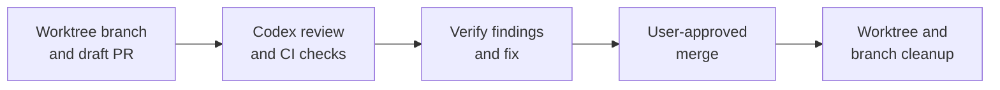

# agent-harness

The skills, hooks, rules and scripts I use every day to build software with Claude Code, with Codex
as the second reviewer, cleaned up to share. They cover how a change is made, reviewed and checked,
and how the agent's instructions improve from what happens in real sessions.

Start with:

- [self-optimize](docs/self-optimize.md): find recurring corrections and test instruction changes.
- [transcripts](skills/transcripts/SKILL.md): search past sessions and read what led to a decision.
- [Review workflow](skills/ship/SKILL.md): review, fix and prepare a change for the user's merge.

## Positions

- The agent takes clear, in-scope steps and asks for the user's decisions.
  [Decide or ask](docs/decide-or-ask.md)
- A bug gets a failing test, a fix at its cause and verification in use.
  [Engineering](rules/engineering.md#test-first-bug-fixes), [core rules](rules/core-rules.md)
- Changes stay within the request; review suggestions do not expand it.
  [Changes](rules/engineering.md#surgical-changes),
  [review suggestions](rules/communication.md#surface--scope-in)
- Edits use worktrees, and the user decides every merge. [Worktrees](rules/core-rules.md#worktrees)
- A second model reviews each PR; its findings are verified before acceptance.
  [Review](skills/ship/SKILL.md), [verification](skills/external-feedback/SKILL.md)
- Instruction changes are tested against real-session cases and checked again after use.
  [self-optimize](docs/self-optimize.md)

## What is here

- [rules/](rules/): always-loaded instructions for execution, engineering and communication.
- [skills/](skills/): procedures loaded when a task needs them.
- [hooks/](docs/hooks.md): six checks on Claude Code's tool calls and replies.
- [scripts/](scripts/): shared tools for Codex jobs, command output and Git state.
- [tests/](tests/): automated checks and a [manual install check](tests/container/run.sh).

## Install

**Full setup**

Needs Python 3.14 or newer as `python3` ([requirements](#requirements)). Clone, then link into
`~/.claude`, where Claude Code loads the rules and skills:

```bash
git clone https://github.com/msantana09/agent-harness
mkdir -p ~/.claude/rules ~/.claude/skills ~/.claude/scripts ~/.claude/hooks ~/.agents/skills
ln -s "$PWD"/agent-harness/rules/*.md ~/.claude/rules/
ln -s "$PWD"/agent-harness/skills/* ~/.claude/skills/
ln -s "$PWD"/agent-harness/scripts/*.sh ~/.claude/scripts/
ln -s "$PWD"/agent-harness/scripts/codex ~/.claude/scripts/
ln -s "$PWD"/agent-harness/skills/inspect-pr ~/.agents/skills/
cp -R agent-harness/hooks/. ~/.claude/hooks/
[ -e ~/.claude/settings.json ] || cp agent-harness/settings.json ~/.claude/settings.json
```

If you already have `~/.claude/settings.json`, merge the repo's `hooks` key into it. Otherwise,
the last command copies the settings. The `~/.agents/skills` link lets Codex load inspect-pr
for reviews.

With the rules installed, the agent files a GitHub issue in the repo it is working in for each
defect it finds and does not fix, and creates the `finding` and `priority` labels there if they
are missing. The rules also opt you in to the agent launching Workflows without asking first;
delete the "Standing authorization" paragraph under Orchestrator Mode in `rules/automation.md` to
be asked before each run.

**Skills only**

Install the Claude Code plugin to try skills such as self-optimize without the full setup:

```text
/plugin marketplace add msantana09/agent-harness
/plugin install agent-harness@msantana09
```

Plugin commands use a prefix, such as `/agent-harness:self-optimize`. The plugin includes no
rules, hooks or shared scripts; codex, ship, command-output-patterns and agent-patterns need
the full setup above.

**Updating**

For the full setup, pull the clone, re-run the `ln` and `cp` commands, and merge any new `hooks`
entries from the repo's `settings.json` into yours. Existing links report "File exists" and
stay unchanged.

## Requirements

[Claude Code](https://code.claude.com) and Python 3.14 or newer as `python3`. The Python scripts
use only the standard library. The review workflow also needs the
[Codex CLI](https://developers.openai.com/codex/cli) and GitHub CLI `gh`, both signed in.

**Checks**

CI runs `python3 -m pytest -q`, `ruff check .` and `ruff format --check .`. The manual
[install check](tests/container/run.sh) needs Docker and a Claude login. It covers hooks,
`/commit`, `triage_run.sh`, `git_state.sh` and self-optimize, not ship or the Codex review.

## How a change ships

Follow the change from its worktree branch through review and checks to the user's merge.



## Read next

- [What the agent decides alone and what it asks](docs/decide-or-ask.md)
- [The hooks](docs/hooks.md)
- [self-optimize](docs/self-optimize.md)

## Contributing

Issues are welcome. The repo records how I work, so it does not take pull requests.

## License

[MIT](LICENSE).
