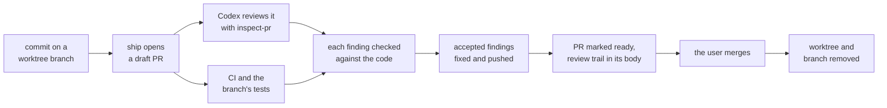

# agent-harness

The skills, hooks, rules and scripts I use every day to build software with Claude Code, with Codex
as the second reviewer, cleaned up to share. They cover how a change is made, reviewed and checked,
and how the agent's instructions improve from what happens in real sessions.

## Positions

- The agent takes an obvious next step and asks only what is the user's to decide: a schema, a
  public contract, spend, a limit that takes something away.
  [core-rules](rules/core-rules.md), [decide or ask](docs/decide-or-ask.md)
- A fix is done when it is seen working where the user meets it, not when the code changed.
  [core-rules](rules/core-rules.md)
- A bug gets a failing test first, then a fix at its cause, and one instance starts a search for
  the rest. [core-rules](rules/core-rules.md)
- A change touches only what the request needs and removes what it replaces.
  [engineering](rules/engineering.md#surgical-changes)
- Every edit happens in a worktree, and a person merges. [core-rules](rules/core-rules.md#worktrees)
- A pull request is reviewed by a second model, again only after a finding of medium severity or
  worse, and each finding is checked against the code before it is accepted.
  [ship](skills/ship/SKILL.md), [external-feedback](skills/external-feedback/SKILL.md)
- A reviewer's suggestion is a recommendation, not scope.
  [communication](rules/communication.md#surface--scope-in)
- A reply fits one phone screen, outcome first. [communication](rules/communication.md)
- Instructions change on evidence: corrections in real sessions, counted before and after.
  [self-optimize](docs/self-optimize.md)

## How a change ships

Read it left to right: the agent does every step but the merge.



## What is here

- `rules/`: the four files every session loads: [core-rules](rules/core-rules.md),
  [engineering](rules/engineering.md), [communication](rules/communication.md) and
  [automation](rules/automation.md).
- `skills/`: procedures the agent loads when a task calls for one. The review set is
  [ship](skills/ship/SKILL.md), [inspect-pr](skills/inspect-pr/SKILL.md),
  [codex](skills/codex/SKILL.md), [external-feedback](skills/external-feedback/SKILL.md),
  [commit](skills/commit/SKILL.md) and
  [command-output-patterns](skills/command-output-patterns/SKILL.md); beside it,
  [default-stack](skills/default-stack/SKILL.md) and
  [agent-patterns](skills/agent-patterns/SKILL.md).
  [transcripts](skills/transcripts/SKILL.md) reads past sessions through a SQLite index with
  full-text search: a derived cache that updates as files change and rebuilds itself when deleted.
  [self-optimize](skills/self-optimize/SKILL.md) counts where the agent was corrected in those
  sessions and tests a change to its instructions before proposing it.
- `hooks/`: six checks Claude Code runs on the agent's tool calls and replies
  ([hooks](docs/hooks.md)).
- `scripts/`: what the rules and skills run by path: `codex-jobs` for Codex reviews and tasks,
  `triage_run.sh` for a long command's failures, `git_state.sh` for a repo's state on one line.
- `tests/`: the tests, and a release check that installs the repo on a clean machine in a
  container and runs it there.

## Install

Clone, then link into `~/.claude`, where Claude Code loads rules and skills and where the rules
name the scripts:

```bash
git clone https://github.com/msantana09/agent-harness
mkdir -p ~/.claude/rules ~/.claude/skills ~/.claude/scripts ~/.claude/hooks ~/.agents/skills
ln -s "$PWD"/agent-harness/rules/*.md ~/.claude/rules/
ln -s "$PWD"/agent-harness/skills/* ~/.claude/skills/
ln -s "$PWD"/agent-harness/scripts/* ~/.claude/scripts/
ln -s "$PWD"/agent-harness/skills/inspect-pr ~/.agents/skills/
cp -R agent-harness/hooks/. ~/.claude/hooks/
[ -e ~/.claude/settings.json ] || cp agent-harness/settings.json ~/.claude/settings.json
```

The last line copies the settings only when you have no `~/.claude/settings.json`; when you do,
merge the `hooks` key of the repo's file into yours. The `~/.agents/skills` link is for Codex,
which loads inspect-pr from there when it reviews for ship. To update, pull the clone and copy the
hooks again.

To try the skills alone, install them as a Claude Code plugin. It carries no rules, hooks or
scripts, so codex, ship, command-output-patterns and agent-patterns, which run the scripts, need
the install above. Its skills take a prefix, as in `/agent-harness:self-optimize`:

```text
/plugin marketplace add msantana09/agent-harness
/plugin install agent-harness@agent-harness
```

## Requirements

[Claude Code](https://code.claude.com); Python 3.14 or newer as `python3` (standard library only;
the one macOS ships is too old); for the review set, the
[Codex CLI](https://developers.openai.com/codex/cli) and the GitHub CLI `gh`, both signed in.

## Read next

- [What the agent decides alone and what it asks](docs/decide-or-ask.md)
- [The hooks](docs/hooks.md)
- [self-optimize](docs/self-optimize.md)

## Contributing

Issues are welcome. The repo records how I work, so it does not take pull requests.

## License

[MIT](LICENSE).
