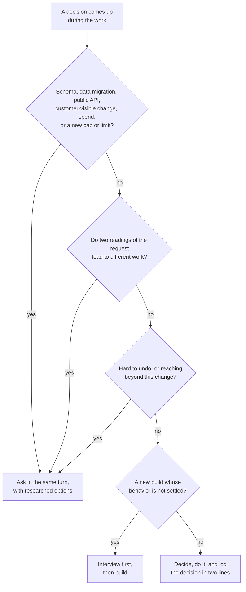

# Decide or ask

An agent that asks about everything is no faster than doing the work yourself, and one that asks
about nothing makes calls that were never its to make. The rules draw the line by who owns the
decision, not by how sure the agent feels. The full text is in
[core-rules](../rules/core-rules.md) under ACT BY DEFAULT.

## The line

Follow one decision from the top: the first yes sends it to the user, and four no's leave it with
the agent.



## What the agent decides alone

Everything the chart does not send to the user, including calls that only come up mid-work:

- Verification is never a question. Reading a file, running a search or checking whether
  something exists is done, not proposed.
- A found cause with a clear fix is fixed. Options are offered only when the design is open.
- A command the agent can run, it runs. A step is handed to the user only when it needs an
  authority only the user holds, and then with every value filled in.

What it decides alone has to be built to last. When the agent cannot tell which option lasts, that
is the signal to ask.

## What it always asks

- The shape of a database schema, and any data migration.
- A public API contract, and anything a customer sees.
- Anything that spends money.
- Any cap, limit, truncation or timeout that reduces what the request, or the thing being
  replaced, could do. A constraint nobody asked for is a regression, not a design choice.

One exception: in a project whose `CLAUDE.md` says it is pre-revenue, a clearly right call on
wording, on the shape of a security fix or on spend under a cent is made and logged, not asked.

A question goes through the AskUserQuestion tool in the turn it comes up, after the agent has read
enough to make the options concrete. It is never left in a pull request body or a report as an
open item.

## The record

A decision made alone is logged in two lines, in the running list and in the pull request body:

```text
Decision: <what was chosen>
Instead of: <the alternative not taken>
```

The reasoning is given when asked for. A pull request that removes something a user could do
before says so above its divider, under `Regresses:`, where the person merging reads it.

## What enforces it

Two checks run when the agent ends its turn ([hooks](hooks.md)): a reply that asks its question in
prose, or offers a step it could have taken, is sent back.
