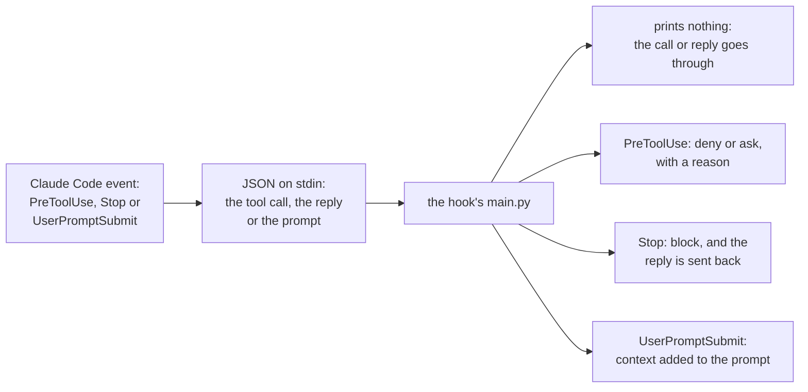

# Hooks

A hook is a small Python script Claude Code runs at a fixed point in a session. A rule asks the
agent to behave a certain way; a hook checks that it did. Each one here exists because a rule
alone was not enough.

## What a hook sees and returns

Follow one event from Claude Code to the hook's answer: the hook reads one JSON payload and either
prints nothing or prints a decision with its reason, which the agent reads.

## The six hooks

| Hook | Runs | What it does |
|---|---|---|
| `emoji_guard` | before a write | Refuses emoji in docs and text files, and asks before writing them into code. |
| `edit_trailing_space_guard` | before an edit | Refuses a replacement that ends in a space or tab, which the Edit tool drops outside Markdown files. |
| `stop_flag` | when the user sends a prompt | Marks the session when the prompt is a bare "stop", and clears the mark on the user's next prompt. |
| `stop_gate` | before every tool call | Refuses the tool calls of a session marked by `stop_flag`. |
| `prose_question_blocker` | when the agent ends its turn | Sends back a reply that asks a question in prose instead of through AskUserQuestion, offers a step instead of taking it, announces work it never started, or uses blockquote bars. |
| `peer_reply_guard` | when the agent ends its turn | Sends back a session that answered another session's task in its own chat instead of with SendMessage. |

The two write guards are registered to block the call when the hook itself cannot
start, so a broken install is noticed. `stop_flag`, `stop_gate` and the two reply checks let the
call or reply through when they fail or their file is missing, so a broken hook can never lock
a session.

Each hook's `main.py` opens with what it reads, what it prints and every decision it makes. Its
tests sit beside it in `tests/`.

## Install

The [README](../README.md#install) copies the hooks into `~/.claude/hooks/`. The repo's
`settings.json` holds only a `hooks` key that registers each one: every command there runs a
hook's `main.py` from that folder with `python3`. Hooks run on your machine on every tool call,
so read one before you register it.

## Turning a check off for a project

A project whose drafts legitimately hold questions, such as a documentation repo, turns off the
question, announcement and blockquote checks of `prose_question_blocker` with an empty file named
`.claude/prose-questions-ok` in the folder its sessions start from. The opt-out holds only while
the session's latest file edit or directory change is inside that folder: once the work moves to
another project, every check runs again. The check for an offered step stays on. A single reply
opts out of all four with the marker `<!-- ask-ok -->`.
