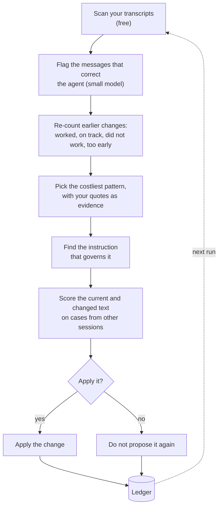

# self-optimize

Improves your agent's instructions from your own Claude Code sessions. It finds where you
corrected the agent, picks the pattern that costs you most, and proposes the change that would
have prevented it. The change is tested before you see it and applied only when you say yes. Later
runs count the same corrections again to check whether it worked.

```text
/self-optimize
```

## The loop



1. **Scan** counts sessions, interrupted turns, hook blocks, other failed tool calls, skills that
   never load and spend. It reads files only and costs nothing.
2. **Flag corrections**: a small model reads the messages you typed, each with up to the last 400
   characters of the agent's reply, question or rejected command that came before it, and flags
   the ones that correct the agent or state a preference. Each one is quoted exactly from the
   transcript. The
   script says roughly what this costs as it starts; a week of heavy use is about $0.15 at list
   price.
3. **Re-count** each change applied on an earlier run, per session, against the count from
   before it.
4. **Pick, diagnose and test** one pattern. The cases that score the change come from sessions
   the diagnosis did not use.
5. **Propose**: the quotes, the change, its score and a review by a second agent. Nothing changes
   until you say yes.

## Install

As part of the agent-harness plugin, where it runs as `/agent-harness:self-optimize`. In Claude
Code, run:

```text
/plugin marketplace add msantana09/agent-harness
/plugin install agent-harness@agent-harness
```

Or on its own, copied into your skills folder with the transcripts skill it reads sessions
through, where it runs as `/self-optimize`:

```bash
git clone https://github.com/msantana09/agent-harness
cp -r agent-harness/skills/self-optimize agent-harness/skills/transcripts ~/.claude/skills/
```

Needs Claude Code and Python 3.14 or newer, run as `python3`; tested on 3.14 and 3.15. No other
dependencies.

Reports, test cases and the ledger stay on your machine in `~/.claude/self-optimize/`, since they
quote your messages.

## Limits

- It reads Claude Code transcripts only.
- Flagging corrections sends your typed messages to a Claude model, each with up to the last 400
  characters of the agent's reply, question or rejected command that came before it.
- "Worked" means the correction came up less often afterward. It does not prove the change was
  the reason.
